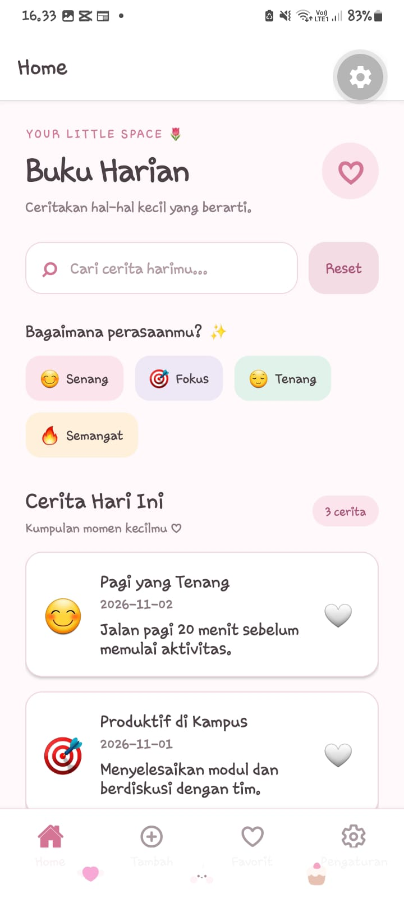
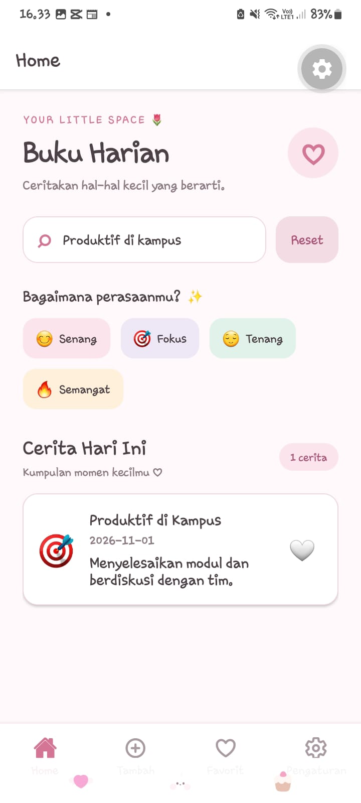
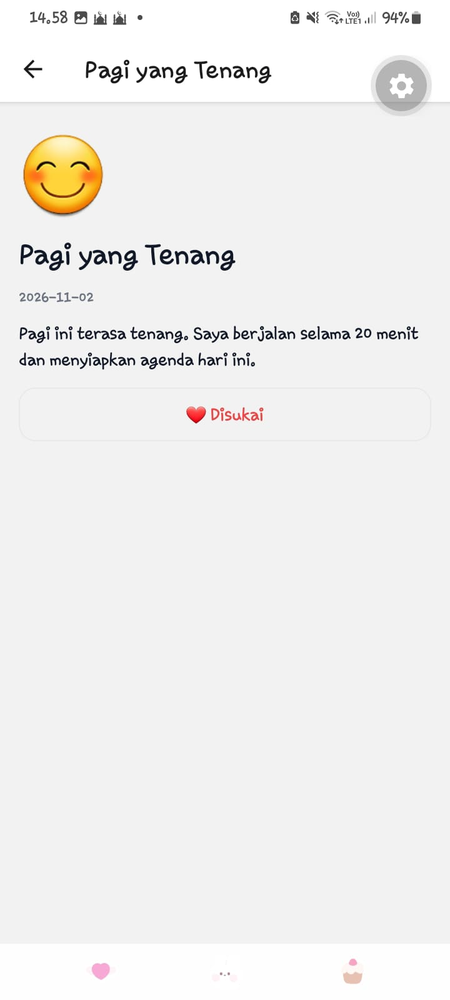
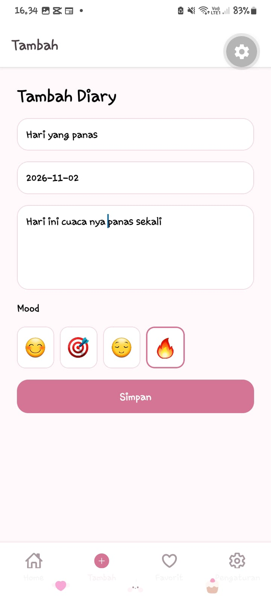
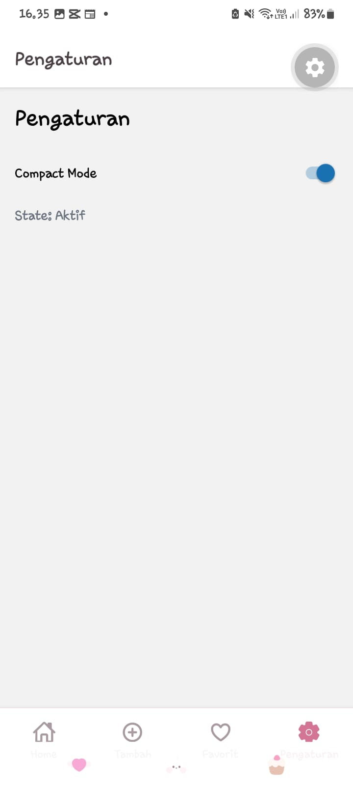

# 🌸 Diary App - Modul 6 Praktikum Pemrograman Perangkat Bergerak

Aplikasi buku harian (*Diary App*) berbasis **Expo Router (React Native & TypeScript)** dengan tema antarmuka *soft pastel* yang dirancang untuk mencatat momen-momen berharga sehari-hari secara interaktif, lengkap dengan fitur pencarian, filter suasana hati (*mood*), sistem penyimpanan favorit (*likes*), serta kustomisasi pengaturan.

---

## 👩‍💻 Identitas Pembuat
* **Nama**: [Reva Dwi Nurrahma]
* **NIM**: [2430511041]
* **Kelas**: [5C]

---

## 🚀 Cara Menjalankan Project


1. **Clone repository atau buka folder project**:
   ```bash
   cd diary-app6
2. **Instal dependensi package:**
    ```Bash
    npm install 
3. **Jalankan aplikasi menggunakan Expo:**
    ```Bash
    npx expo start -c

Gunakan aplikasi Expo Go di perangkat seluler (Android/iOS) untuk memindai QR Code yang muncul di terminal, atau jalankan pada emulator/simulator pilihanmu. 

## 📸 Tangkapan Layar (Screenshots UI)

| Home | Search | Detail |
| :---: | :---: | :---: |
|  |  |  |
| *Beranda utama aplikasi dengan daftar catatan dan filter mood.* | *Fitur pencarian dan penyaringan entri harian secara instan.* | *Halaman baca penuh untuk melihat detail isi cerita harian.* |

| Create | Favorites | Settings |
| :---: | :---: | :---: |
|  |  |  |
| *Formulir interaktif untuk membuat entri diary baru.* | *Tab khusus untuk mengelompokkan catatan favorit/disukai.* | *Halaman pengaturan dan informasi seputar aplikasi.* |

## 🪝 Penjelasan Hooks yang Digunakan

Berikut adalah daftar *React Hooks* yang diimplementasikan dalam pengembangan aplikasi *Diary App*:

| Hook | Fungsi & Penjelasan dalam Aplikasi |
| :--- | :--- |
| **`useState`** | Digunakan untuk mengelola state lokal pada komponen, seperti menyimpan nilai input teks pada form tambah/edit diary, mengelola status tombol *favorit* (like/unlike), serta mengontrol daftar data catatan yang sedang ditampilkan. |
| **`useEffect`** | Digunakan untuk menangani efek samping (*side effects*), seperti memuat data awal catatan harian dari penyimpanan lokal (*AsyncStorage*) saat aplikasi pertama kali dibuka (*mounted*), serta menyinkronkan perubahan data. |
| **`useMemo`** | Digunakan untuk mengoptimalkan performa aplikasi dengan cara *memoizing* hasil penyaringan (*filtering*) data catatan berdasarkan kata kunci pencarian atau kategori *mood*, sehingga proses *rendering* ulang tidak melambat saat daftar catatan bertambah banyak. |